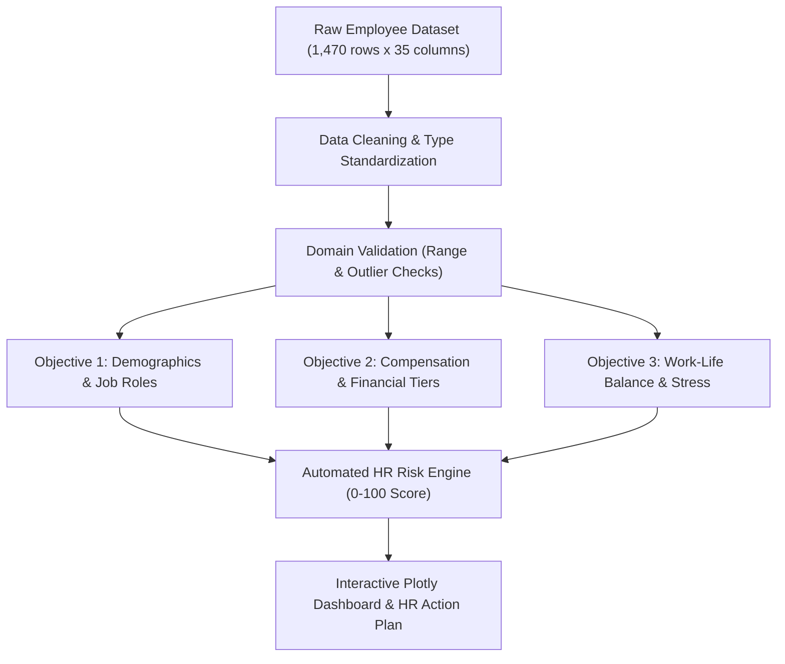

# 📊 Employee Attrition Analysis & Retention Risk Modeling

[](file:///employee_attrition_analysis.R)
[](file:///employee_attrition_analysis.R)
[](file:///employee_attrition_analysis.R)
[](file:///employee_attrition_analysis.R)

> An end-to-end data science and statistical analysis project in **R** investigating the root causes of employee turnover. Features rigorous exploratory data analysis (EDA), hypothesis testing, logistic regression modeling, an automated **Employee Retention Risk Scoring Algorithm (0–100)**, and an interactive Plotly dashboard for HR decision-makers.

---

## 📌 Executive Summary

Employee turnover incurs significant recruitment, onboarding, and productivity costs. Using a rich enterprise dataset of **1,470 employees across 35 attributes**, this project conducts an in-depth empirical investigation into how demographic attributes, compensation tiers, work-life balance, and job strain influence retention.

### Project Team & Role
- **Lead Analyst & Codebase Author:** **Chan Hua Shean** (Led team of 3; authored complete R codebase for data cleaning, statistical modeling, visualizations, and ~70% of project documentation).
- **Collaborators:** Clement Kek Ching Haow, Li Aoyu (Asia Pacific University).

---

## 🎯 Analytical Objectives & Core Findings



### 1. Factors Influencing Employee Attrition (Demographics & Job Roles)
- **Age & Career Stage:** Employees in the **18–25 age bracket** exhibit the highest attrition rate (~38%), driven by entry-level compensation and career mobility, compared to <12% for employees aged 40+.
- **Departmental Hotspots:** The **Sales Department** suffers the highest turnover, with **Sales Representatives** identified as the highest-risk single job role.
- **Marital Status:** Single employees leave at more than double the rate of married or divorced peers.
- **Gender Invariance:** Chi-square tests confirmed that gender does **not** have a statistically significant relationship with turnover ($p > 0.05$).

### 2. Compensation & Financial Incentives Impact
- **Monthly Income:** Strongest single compensation predictor ($p < 0.001$). Attrition heavily concentrates in the lowest income quartile ($< \$2,900/\text{month}$).
- **Stock Option Grants:** Employees with Stock Option Level 0 have more than triple the attrition rate of peers with Level 1 or 2 options.
- **Composite Compensation Score:** A normalized index combining salary, hourly rate, and equity participation demonstrated sharp divergence between stayers and leavers.

### 3. Work-Life Balance, Overtime & Commute Distance
- **Overtime is the #1 Behavioral Predictor:** Logistic regression confirms overtime is the single most damaging factor ($\beta \approx 1.2, p < 0.001$).
- **The Toxic Compound Effect:** Employees experiencing **both** mandatory overtime and frequent business travel have an attrition rate exceeding **50%**.
- **Commute Distance Threshold:** Commutes $> 15\text{ miles}$ increase attrition by ~30% compared to commutes $< 5\text{ miles}$ ($p < 0.001$).
- **Work-Life Balance Score:** Employees rating WLB as Level 1 ("Poor") have an attrition rate $> 30\%$, compared to $< 10\%$ for Level 4 ("Very High").

---

## ⚙️ Advanced Features

### 1. Automated Employee Retention Risk Engine (0–100)
A deterministic multi-factor risk scoring algorithm implemented in R to flag at-risk talent prior to resignation:
```r
# Evaluates overtime, job satisfaction, commute, income percentile, and travel
risk_score <- calculate_risk_score(employee)
# Categorized into: Minimal Risk (<20), Low Risk (20-39), Medium Risk (40-69), High Risk (>=70)
```

### 2. Interactive Plotly Dashboard
- Generates a standalone, interactive HTML dashboard (`attrition_dashboard.html`) allowing HR managers to dynamically slice turnover rates by department, average salary, and headcount.

---

## 🛠️ Tech Stack & Packages

- **Language:** R (tested on R 4.3+)
- **Data Wrangling:** `tidyverse`, `dplyr`, `tidyr`, `reshape2`
- **Statistical Modeling:** `stats` (`glm` binomial logistic regression), `caret`, `corrplot`
- **Visualization:** `ggplot2`, `GGally`, `gridExtra`, `scales`, `RColorBrewer`
- **Interactive UI:** `plotly`, `htmlwidgets`, `DT`

---

## 📂 Repository Structure

```text
├── employee_attrition_analysis.R         # Complete 1,900+ line production analysis script
├── dataset_employee_attrition.csv       # Cleaned benchmark dataset (1,470 records)
├── 3. Dataset description.txt           # Data dictionary detailing 35 variables
├── Group 24 Programming for data analysis.R # Original coursework submission script
├── .gitignore                           # Excludes R session temp files (.Rhistory, .RData)
└── README.md                            # Comprehensive project documentation
```

---

## 🚀 How to Run the Analysis

### Option A: Using RStudio (Recommended)
1. Clone this repository:
   ```bash
   git clone https://github.com/YOUR_USERNAME/employee-attrition-analysis.git
   cd employee-attrition-analysis
   ```
2. Open `employee_attrition_analysis.R` inside **RStudio**.
3. Install required dependencies:
   ```r
   install.packages(c("tidyverse", "ggplot2", "dplyr", "tidyr", "corrplot", 
                      "caret", "plotly", "htmlwidgets", "gridExtra", "scales"))
   ```
4. Run the script! The script features an **auto-detecting working directory** routine that locates the dataset automatically.
5. Inspect the generated figures and open `attrition_dashboard.html` in any web browser.

### Option B: Running from Terminal / Command Line
```bash
Rscript employee_attrition_analysis.R
```

---

## 👤 Author & Academic Background

- **Chan Hua Shean**
- Asia Pacific University of Technology & Innovation (APU)
- Bachelor of Computer Science (Hons) in Artificial Intelligence
- [LinkedIn Profile](https://www.linkedin.com/in/chanhuashean) · [Email](mailto:hschan0420@gmail.com)
